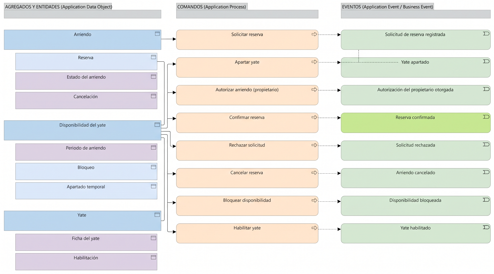

# V6a. Gestión del arriendo

Dominio **Core**. Es donde se decide si un yate puede comprometerse con un cliente en unas fechas y una marina. La vista reúne tres agregados que hasta ahora vivían juntos en V5: el arriendo, la disponibilidad del yate y el propio yate.

## Agregados

| Raíz de agregado | Entidades y objetos de valor | Invariante principal |
| --- | --- | --- |
| **Arriendo** | Reserva (entidad), Estado del arriendo (valor), Cancelación (valor) | Solo se confirma con la elegibilidad aprobada y, cuando el acuerdo lo exija, con la autorización del propietario. Una reserva confirmada no autoriza la entrega. |
| **Disponibilidad del yate** | Periodo de arriendo (valor), Bloqueo (entidad), Apartado temporal (entidad) | Dos periodos confirmados sobre el mismo yate no pueden solaparse. Un bloqueo impide confirmar, y liberar un compromiso ya confirmado obliga a gestionar el incumplimiento. |
| **Yate** | Ficha del yate (valor), Habilitación (valor) | Un yate pertenece a un único propietario y a una única marina. El propietario decide si está habilitado o bloqueado. |

Arriendo, Reserva y Disponibilidad del yate ya existían como `DataObject` desde la fase 3. Se dejaron como estaban y solo se les marcó su tipo DDD y su invariante. Yate es nuevo, porque en V5 la flota aparecía más como capacidad de negocio que como concepto de este dominio.

## Comandos y eventos

| Comando | Agregado | Evento |
| --- | --- | --- |
| Solicitar reserva | Arriendo | Solicitud de reserva registrada *(dominio)* |
| Apartar yate | Disponibilidad del yate | Yate apartado *(dominio)* |
| Autorizar arriendo (propietario) | Arriendo | Autorización del propietario otorgada *(dominio)* |
| Confirmar reserva | Arriendo | Reserva confirmada *(negocio)* |
| Rechazar solicitud | Arriendo | Solicitud rechazada *(negocio)* |
| Cancelar reserva | Arriendo | Arriendo cancelado *(negocio)* |
| Bloquear disponibilidad | Disponibilidad del yate | Disponibilidad bloqueada *(dominio)* |
| Habilitar yate | Yate | Yate habilitado *(dominio)* |

## Notas de diseño

La confirmación exige haber pasado por la evaluación de riesgo. Ese cruce con otro dominio se representa como una invariante del agregado Arriendo y no como un comando propio: Gestión del arriendo consulta un resultado, no evalúa por sí misma.

El apartado temporal se separó del bloqueo porque no son lo mismo. Un apartado reserva el periodo unas horas mientras se cierran las condiciones; un bloqueo lo inhabilita por decisión del propietario o por mantenimiento. Ambos viven dentro de Disponibilidad del yate porque afectan el mismo compromiso sobre el calendario.

Rechazar solicitud, cancelar reserva y confirmar reserva disparan eventos de negocio, no solo de dominio. Un rechazo o una cancelación cambian el estado del yate para la marina y para el propietario, y por eso se marcaron como `BusinessEvent`.
