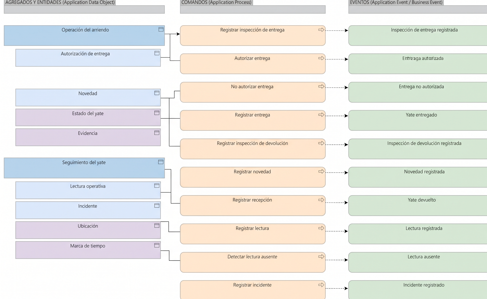

# V6c. Operación y seguimiento del yate

Dominio **Core**. Cubre el estado físico del yate entre la preparación y la recepción. En la fase 3 se decidió mantener entrega, seguimiento y devolución juntos porque comparten el conocimiento sobre el mismo yate; aquí ese conjunto se reparte en dos agregados.

## Agregados

| Raíz de agregado | Entidades y objetos de valor | Invariante principal |
| --- | --- | --- |
| **Operación del arriendo** | Inspección del yate (entidad), Autorización de entrega (entidad), Novedad (entidad), Estado del yate (valor), Evidencia (valor) | No se autoriza la entrega sin inspección completa y yate apto, y ninguna entrega ocurre sin autorización aunque el pago esté hecho. Toda devolución deja acta con el mismo checklist de la entrega. Registrar una novedad no atribuye responsabilidad. |
| **Seguimiento del yate** | Lectura operativa (entidad), Incidente (entidad), Ubicación (valor), Marca de tiempo (valor) | Cada lectura lleva su hora de medición; una lectura ausente no equivale a cero. El sistema alerta, pero no atiende el incidente. |

Inspección del yate, Lectura operativa e Incidente ya existían desde la fase 3. Operación del arriendo y Seguimiento del yate aparecen como raíces nuevas que agrupan esos conceptos.

## Comandos y eventos

| Comando | Agregado | Evento |
| --- | --- | --- |
| Registrar inspección de entrega | Operación del arriendo | Inspección de entrega registrada *(dominio)* |
| Autorizar entrega | Operación del arriendo | Entrega autorizada *(dominio)* |
| No autorizar entrega | Operación del arriendo | Entrega no autorizada *(dominio)* |
| Registrar entrega | Operación del arriendo | Yate entregado *(dominio)* |
| Registrar inspección de devolución | Operación del arriendo | Inspección de devolución registrada *(dominio)* |
| Registrar novedad | Operación del arriendo | Novedad registrada *(dominio)* |
| Registrar recepción | Operación del arriendo | Yate devuelto *(negocio)* |
| Registrar lectura | Seguimiento del yate | Lectura registrada *(dominio)* |
| Detectar lectura ausente | Seguimiento del yate | Lectura ausente *(dominio)* |
| Registrar incidente | Seguimiento del yate | Incidente registrado *(dominio)* |

## Notas de diseño

Autorizar entrega y registrar entrega se mantuvieron como comandos separados porque son decisiones distintas: la primera es una autorización operativa y la segunda deja constancia de que el yate salió. Una autorización puede existir sin que la entrega ocurra todavía.

El estado del yate y la evidencia son objetos de valor del agregado, no entidades independientes. Se comparan por su contenido (el checklist, las fotos) y no tienen identidad propia fuera del arriendo.

Registrar novedad no dispara un evento de negocio a propósito. Una novedad es un hallazgo, no un cobro: quién paga y cuánto se decide en Liquidación, a partir de las actas. El yate devuelto sí es un evento de negocio porque marca el fin del uso físico y avisa a otras áreas.
