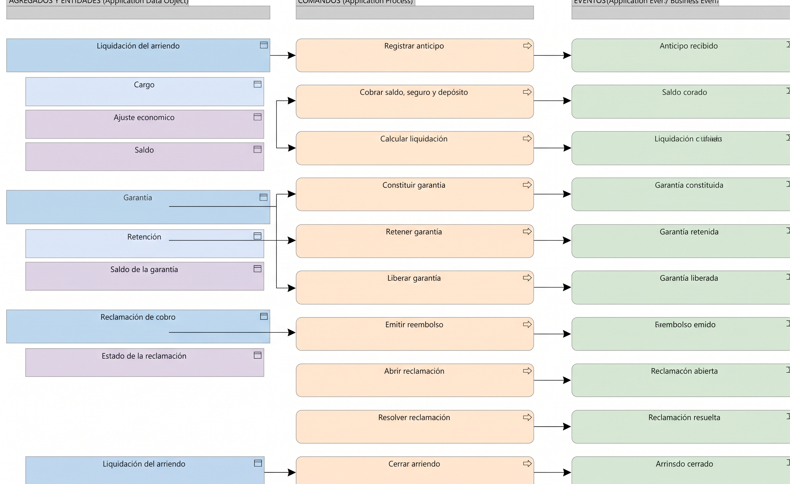

# V6d. Liquidación

Dominio **Supporting**. Resuelve los valores económicos del arriendo: alquiler, garantía, ajustes y reclamaciones, hasta dejarlo cerrado. La vista muestra tres agregados: la liquidación, la garantía y la reclamación de cobro.

## Agregados

| Raíz de agregado | Entidades y objetos de valor | Invariante principal |
| --- | --- | --- |
| **Liquidación del arriendo** | Cargo (entidad), Ajuste económico (valor), Saldo (valor) | Todo cargo se sustenta en evidencia comparada (acta de entrega frente a devolución) y en una condición contractual. El saldo no queda negativo sin un reembolso explícito. |
| **Garantía** | Retención (entidad), Saldo de la garantía (valor) | La garantía no es ingreso: solo se retiene lo sustentado y el saldo se libera o se reembolsa. |
| **Reclamación de cobro** | Estado de la reclamación (valor) | Se resuelve con evidencia y antes del cierre económico; no se cierra el arriendo con reclamaciones abiertas. |

Garantía, Ajuste económico y Reclamación de cobro ya existían. Liquidación del arriendo es nueva y agrupa los cargos y el saldo final, que en V5 no aparecían con esa precisión.

## Comandos y eventos

| Comando | Agregado | Evento |
| --- | --- | --- |
| Registrar anticipo | Liquidación del arriendo | Anticipo recibido *(dominio)* |
| Cobrar saldo, seguro y depósito | Liquidación del arriendo | Saldo cobrado *(dominio)* |
| Calcular liquidación | Liquidación del arriendo | Liquidación calculada *(dominio)* |
| Constituir garantía | Garantía | Garantía constituida *(dominio)* |
| Retener garantía | Garantía | Garantía retenida *(dominio)* |
| Liberar garantía | Garantía | Garantía liberada *(dominio)* |
| Emitir reembolso | Garantía | Reembolso emitido *(dominio)* |
| Abrir reclamación | Reclamación de cobro | Reclamación abierta *(dominio)* |
| Resolver reclamación | Reclamación de cobro | Reclamación resuelta *(dominio)* |
| Cerrar arriendo | Liquidación del arriendo | Arriendo cerrado *(negocio)* |

## Notas de diseño

La garantía se separó de la liquidación aunque las dos tocan dinero. La garantía es un depósito que se constituye, se retiene o se libera; la liquidación calcula el saldo final del arriendo. Retener una garantía no es lo mismo que cobrar un cargo, y tratarlos como agregados distintos mantiene esa diferencia.

Cerrar arriendo es el único comando que produce un evento de negocio, porque es el hito que quita el arriendo de la mesa: ya no quedan pagos, garantías ni reclamaciones pendientes. La operación sensible a retención de dinero se dejó como evento de dominio, ya que la pasarela de pagos y contabilidad la procesan por su lado.
