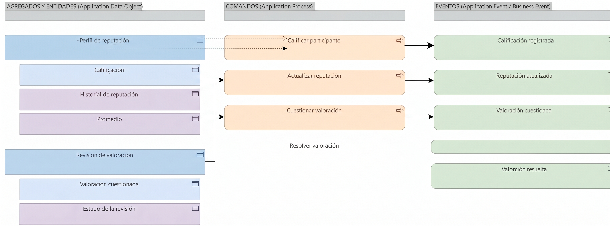

# V6e. Reputación

Dominio **Supporting**. Conserva las calificaciones entre cliente y propietario y revisa las que se cuestionan. La vista muestra dos agregados: el perfil de reputación y la revisión de una valoración.

## Agregados

| Raíz de agregado | Entidades y objetos de valor | Invariante principal |
| --- | --- | --- |
| **Perfil de reputación** | Calificación (entidad), Historial de reputación (valor), Promedio (valor) | Se registra una única calificación por participante y por arriendo. La reputación previa informa, pero no aprueba ni rechaza una reserva. |
| **Revisión de valoración** | Valoración cuestionada (entidad), Estado de la revisión (valor) | Una valoración cuestionada no se publica hasta que la revisión se resuelva. |

Calificación e Historial de reputación ya existían. Perfil de reputación y Revisión de valoración son nuevos, porque en V5 la reputación aparecía como un bloque de conceptos sin distinguir el historial del proceso de revisión.

## Comandos y eventos

| Comando | Agregado | Evento |
| --- | --- | --- |
| Calificar participante | Perfil de reputación | Calificación registrada *(dominio)* |
| Actualizar reputación | Perfil de reputación | Reputación actualizada *(dominio)* |
| Cuestionar valoración | Revisión de valoración | Valoración cuestionada *(dominio)* |
| Resolver valoración | Revisión de valoración | Valoración resuelta *(dominio)* |

## Notas de diseño

Ningún comando de este dominio produce un evento de negocio. La reputación ayuda a generar confianza, pero el arriendo puede confirmarse, ejecutarse y cerrarse sin depender de ella, tal como se argumentó al clasificarla como Supporting en la fase 3.

La revisión de valoración es un agregado aparte del perfil. Una valoración cuestionada queda fuera del perfil hasta que se resuelve, y ese estado intermedio merece su propia raíz para no mezclar el historial publicado con el que está en discusión.

Se admite una sola calificación por participante y por arriendo. Esa regla es la que permite tratar la calificación como entidad del perfil sin que el promedio se infle con votos repetidos.
