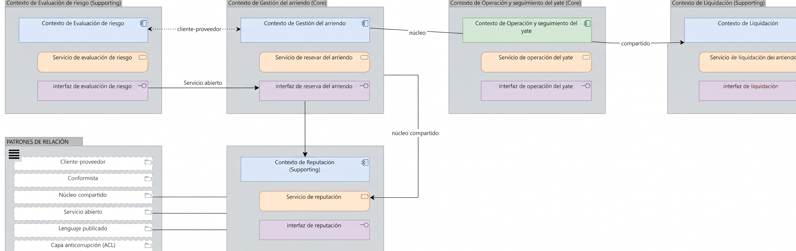

# V8. Mapa de contextos delimitados y patrones

La vista junta los cinco contextos de aplicación, el núcleo compartido y una leyenda de los tiempos de relación usados. Cada contexto se dibuja como un componente de aplicación; cada flecha entre ellos lleva el patrón como nombre.

## Los contextos y sus servicios

| Contexto | Servicio que publica |
| --- | --- |
| Evaluación de riesgo | Servicio de evaluación de riesgo |
| Gestión del arriendo | Servicio de reserva del arriendo |
| Operación y seguimiento del yate | Servicio de operación del yate |
| Liquidación | Servicio de liquidación del arriendo |
| Reputación | Servicio de reputación |

Cada contexto realiza su propio servicio, de modo que la vista explica de dónde sale cada servicio que la fase 2 ya listaba como `ApplicationService` y que V9b consumía.

## Los patrones aplicados

| Desde | Hacia | Patrón | Por qué |
| --- | --- | --- | --- |
| Evaluación de riesgo | Gestión del arriendo | Cliente-proveedor | Gestión necesita el veredicto, pero no controla cómo se calcula. |
| Gestión del arriendo | Operación y seguimiento del yate | Cliente-proveedor | Operación recibe el arriendo confirmado y lo ejecuta (entrega, mantenimiento, devolución). |
| Operación y seguimiento del yate | Liquidación | Cliente-proveedor | Liquidación arma costos y saldos con lo que operación reportó. |
| Gestión del arriendo | Reputación | Servicio abierto + lenguaje publicado, y Reputación como conformista | El arriendo confirmado es el dato que todos entienden. Reputación lo consume tal cual, sin redefinirlo. |
| Núcleo compartido | Gestión del arriendo | Núcleo compartido | Arriendo, yate y participante son comunes a casi todos los contextos. |
| Núcleo compartido | Operación y seguimiento del yate | Núcleo compartido | El yate y su estado operativo se consultan en todo el ciclo. |

La cadena Evaluación → Gestión → Operación → Liquidación es una sola cadena cliente-proveedor, la columna vertebral de la solución: cada eslabón solo habla con su vecino.

El núcleo compartido se dibuja con `Association`, porque no es una llamada entre servicios: es un modelo en común que los contextos consultan y actualizan. Se limitó a tres conceptos (arriendo, yate, participante) a propósito, para que la unión no crezca hasta acoplarlos.

## Notas de diseño

**Por qué Reputación es conformista y no cliente-proveedor puro.** Reputación no requiere nada que solo ella necesite del arriendo. Le basta con lo que Gestión ya publica, sin pedir un contrato a medida. Conformista aquí es una decisión económica, no una rebaja técnica.

**Qué se deja fuera de la vista.** Los eventos de dominio (la fase 4) se disparan dentro de cada contexto, no cruzan la frontera; por eso no aparecen. Los contratos de datos detallados ya están en V9b, y en V8 solo importa quién provee, quién consume y con qué patrón.

**Coherencia con la fase 2.** V9b describía la interoperabilidad en términos de procesos de negocio y sistemas. Lo que esta vista hace es decir cómo esa interoperabilidad se implementa en la capa de aplicación: cada flujo de V9b tiene ahora un canal concreto, aunque los nombres de los sistemas externos no aparecen aquí para no ensuciar el mapa. De eso se encarga V9.