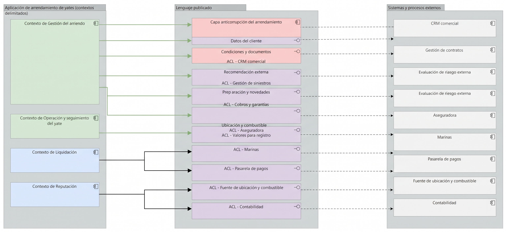

# V8b. Interoperabilidad de aplicación y anticorrupción

La vista tiene tres columnas: a la izquierda los contextos delimitados de la aplicación de arriendo, al centro la **capa anticorrupción (ACL)**, a la derecha los sistemas y procesos externos. La ACL traduce el lenguaje de cada sistema de afuera al del contexto interno; nada externo llama directo a un contexto, todo pasa por la frontera.

## Los sistemas externos y a qué contexto sirven

| Sistema externo | Adaptador ACL | Contexto que lo consume |
| --- | --- | --- |
| CRM comercial | ACL - CRM comercial | Gestión del arriendo |
| Gestión de contratos | ACL - Gestión de contratos | Gestión del arriendo |
| Evaluación de riesgo externa | ACL - Evaluación de riesgo externa | Evaluación de riesgo |
| Aseguradora | ACL - Aseguradora | Operación y seguimiento del yate |
| Marinas | ACL - Marinas | Operación y seguimiento del yate |
| Fuente de ubicación y combustible | ACL - Fuente de ubicación y combustible | Operación y seguimiento del yate |
| Pasarela de pagos | ACL - Pasarela de pagos | Liquidación |
| Contabilidad | ACL - Contabilidad | Liquidación |

El sistema externo entra con un `Flow` a su adaptador de la ACL; el adaptador sirve a su contexto (`Serving`); y la capa anticorrupción agrega a todos sus adaptadores (`Aggregation`). Cada contexto expone además su propia interfaz, asociada al contexto (`Association`), y realiza su servicio (`Realization`). El sistema externo trae su propio formato; el adaptador lo convierte al contrato que el contexto espera, y en sentido inverso cuando el contexto responde.

## Qué traduce la ACL en cada caso

La traducción no es solo de campos. Cada caso cambia forma, nombre o ambos:

- **CRM y Gestión de contratos:** llegan clientes, propietarios y las condiciones pactadas del canal. La ACL los proyecta a los términos del arriendo (cuándo se aparta, cuánto tarda en confirmar).
- **Evaluación de riesgo externa:** entrega puntajes con su propio esquema. El adaptador los traduce a los campos que Evaluación de riesgo espera; el veredicto y la elegibilidad los decide el contexto, no la frontera.
- **Aseguradora:** coberturas y reclamaciones del yate; el adaptador las traduce a los hechos de operación que sigue el contexto de Operación y seguimiento.
- **Marinas:** confirman disponibilidad, amarres y la liberación del yate. El adaptador convierte esos estados en la operación que el contexto entiende.
- **Fuente de ubicación y combustible:** posiciones y niveles de llenado, que la ACL traduce a hitos de seguimiento (entrega, circulación, devolución).
- **Pasarela de pagos:** intentos y resultados de cobro, traducidos a los movimientos de pago que Liquidación registra.
- **Contabilidad:** los movimientos contables, traducidos a los hechos que alimentan la Liquidación.

## Notas de diseño

**Por qué una sola ACL en lugar de una por contexto.** Los sistemas externos son pocos y estables, y sus formatos no cambian a cada rato. Una frontera única mantiene la traducción en un solo lugar y a un mismo idioma en toda la aplicación. Si algún día un contexto necesitara su propia puerta, el patrón no cambia: se agrega una interfaz a la ACL.

**Coherencia con fase 2.** Los ocho sistemas de la derecha son los mismos que aparecen en V9. El criterio de exclusión de la fase 2 se mantiene: no se agregó aquí ningún sistema nuevo, y los que quedaron fuera (autoridad marítima, reportes de zona, etc.) siguen fuera porque no participan en los procesos core que consume esta aplicación.

**Qué no hace la ACL.** No contiene reglas de negocio: solo transforma formato y terminología. Ni la evaluación de riesgo ni la liquidación deciden nada dentro de la frontera; la ACL las sirve, no las reemplaza. Por eso todas sus relaciones con los contextos son `Serving` o de agregación, nunca de composición lógica.